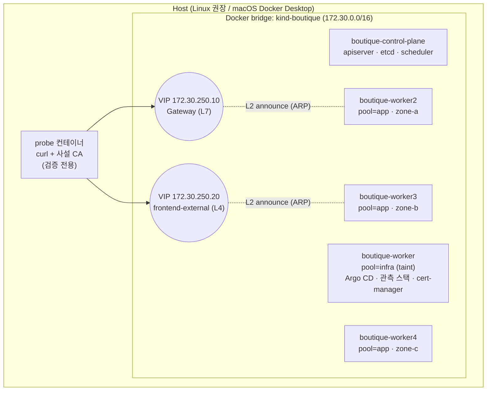
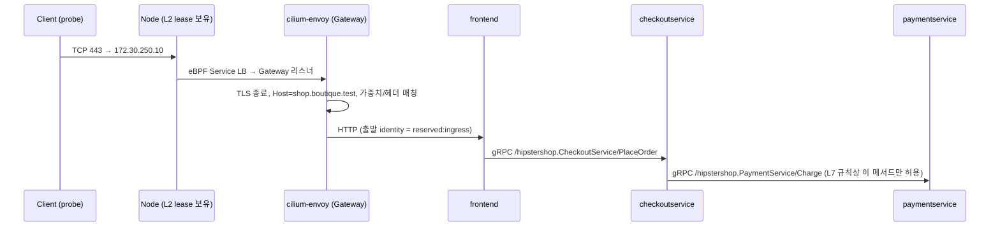
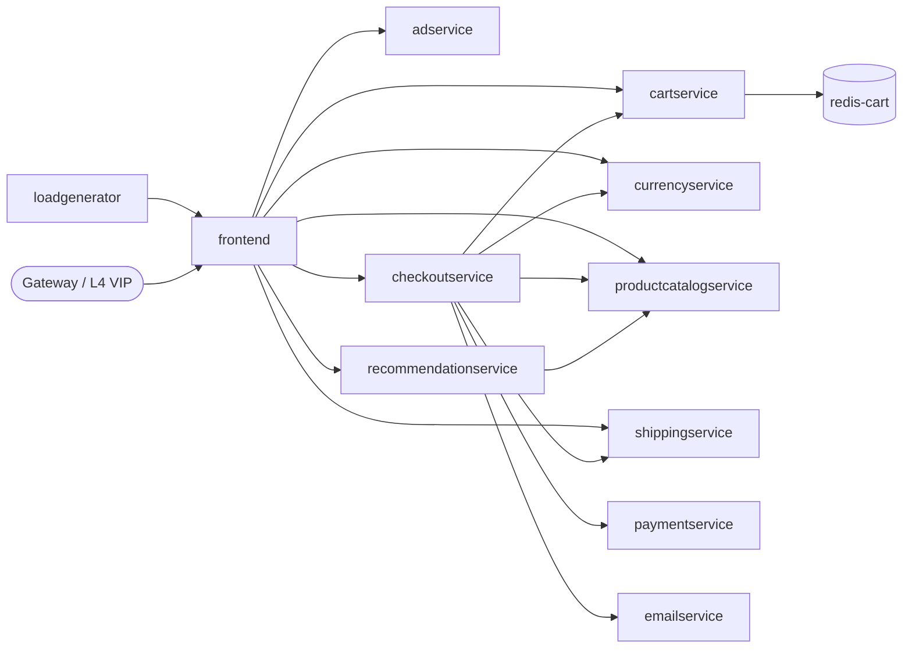
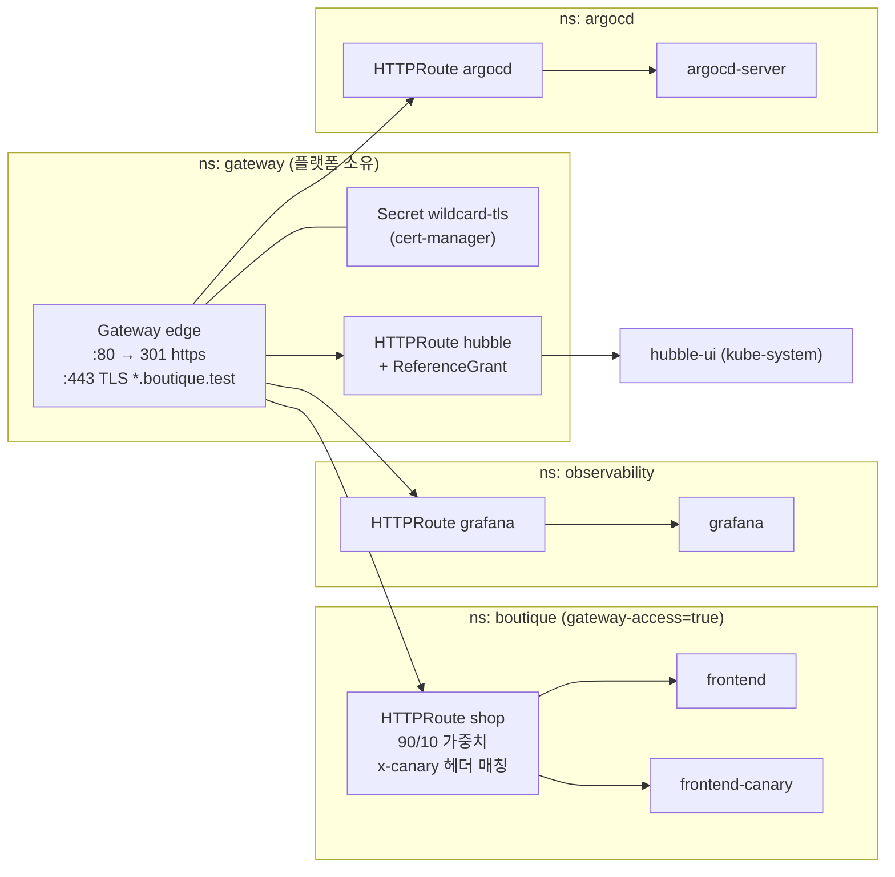
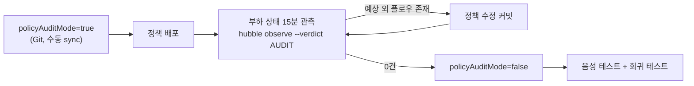
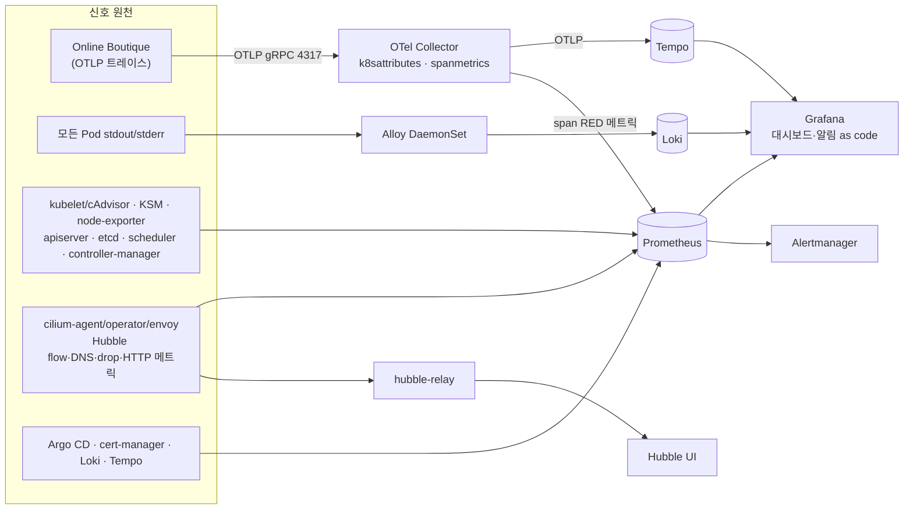
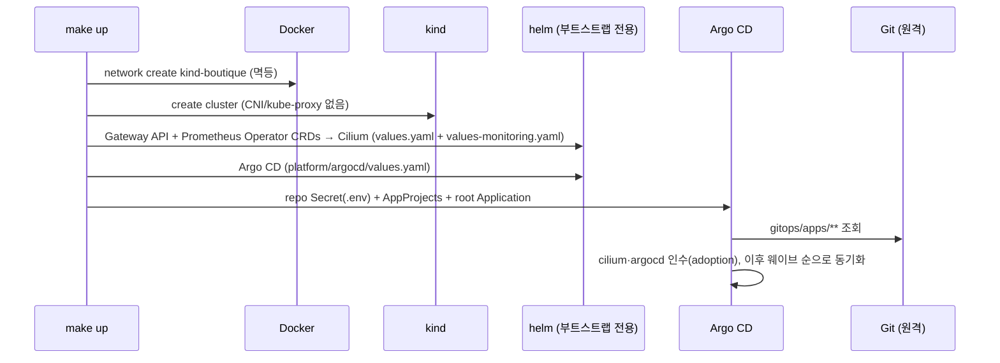

# ARCHITECTURE.md — Online Boutique Platform Lab

| 항목 | 값 |
|---|---|
| 문서 버전 | 1.0 (Draft) |
| 작성일 | 2026-11-14 |
| 관련 문서 | `docs/SPEC.md`(요구사항·완료 기준), `docs/adr/`(결정 기록), `CLAUDE.md`(작업 규칙) |

---

## 1. 개요와 설계 원칙

로컬 단일 호스트에서 "운영 클러스터의 축소판"을 재현한다. 목표는 마이크로서비스(Online Boutique)를
멀티노드·네트워크 격리·L4/L7 부하분산·관측성·GitOps가 갖춰진 환경에 올리고, 각 계층을 **검증 가능한 기준**으로 완성하는 것이다.

| 원칙 | 의미 |
|---|---|
| 단일 데이터플레인 | CNI, kube-proxy 대체, L4 LB, L7 Gateway, 네트워크 정책, 플로우 관측을 Cilium(eBPF + Envoy) 하나로 통합해 구성요소 간 경계 문제를 줄인다 |
| GitOps 우선 | 명령형 작업은 "CNI + Argo CD 부트스트랩"까지만. 그 이후 모든 상태는 Git에서 선언·동기화된다 |
| 기본 거부(Zero Trust) | 애플리케이션 네임스페이스는 default-deny에서 시작해 호출 그래프 기반으로 최소 허용한다 |
| 기본 관측 | 모든 플랫폼 구성요소는 메트릭을 노출하고 수집된다. "보이지 않는 것은 완료가 아니다" |
| 재현성 | 고정 버전 + 고정 서브넷 + 멱등 스크립트. `make down && make up`으로 언제든 동일 환경 |
| 검증 가능성 | 모든 요구사항은 자동화된 AC(Acceptance Criteria)로 판정된다 |

## 2. 전체 구성도



모든 노드에는 Cilium agent(eBPF 데이터플레인)와 cilium-envoy(L7 프록시, Gateway 리스너)가 DaemonSet으로 동작한다.

## 3. 계층 모델

| 계층 | 구성요소 | 책임 | 관리 방식 |
|---|---|---|---|
| L0 Host | Docker, 고정 bridge 네트워크 | 노드 컨테이너, L2 세그먼트 | 스크립트 (`bootstrap/scripts`) |
| L1 Cluster | kind (1 CP + 4 worker), Kubernetes 1.36 | 멀티노드, 존 시뮬레이션 | kind config (Git), 명령형 생성 |
| L2 Datapath/CNI | Cilium (kube-proxy replacement, VXLAN, Maglev) | Pod 네트워킹, Service LB, 정책 집행 | 부트스트랩 helm → Argo CD 인수 |
| L3 Traffic | Cilium LB-IPAM + L2 Announcements (L4), Gateway API on Cilium Envoy (L7), cert-manager | 외부 노출, TLS 종료, 라우팅, 카나리 | Argo CD |
| L4 Delivery | Argo CD (app-of-apps, AppProjects) | 선언적 배포, 드리프트 교정, 롤백 | 부트스트랩 helm → self-managed |
| L5 Observability | kube-prometheus-stack, Loki + Alloy, Tempo + OTel Collector, Hubble, Grafana | 메트릭·로그·트레이스·플로우 | Argo CD |
| L6 Application | Online Boutique v0.10.x (vendored + Kustomize overlay) | 워크로드 | Argo CD (`apps` 프로젝트) |
| 횡단 | NetworkPolicy/CiliumNetworkPolicy, Pod Security Admission | 격리, 최소 권한 | Argo CD (`platform` 프로젝트) |

## 4. 노드 토폴로지와 배치 규칙

| 노드 | 라벨 | Taint | 배치 대상 |
|---|---|---|---|
| boutique-control-plane | (kind 기본) | `node-role.kubernetes.io/control-plane:NoSchedule` | 컨트롤 플레인 + DaemonSet |
| boutique-worker | `node.boutique.io/pool=infra` | `node.boutique.io/dedicated=infra:NoSchedule` | Argo CD, Prometheus, Grafana, Loki, Tempo, OTel Collector, cert-manager, hubble-relay/ui, cilium-operator |
| boutique-worker2 | `node.boutique.io/pool=app`, `topology.kubernetes.io/zone=zone-a` | — | Online Boutique, l4-test |
| boutique-worker3 | `node.boutique.io/pool=app`, `topology.kubernetes.io/zone=zone-b` | — | 〃 |
| boutique-worker4 | `node.boutique.io/pool=app`, `topology.kubernetes.io/zone=zone-c` | — | 〃 |

배치 규칙:
- 인프라 워크로드는 `nodeSelector: node.boutique.io/pool=infra` + 해당 toleration. 앱은 taint 때문에 인프라 노드에 올라가지 않는다.
- DaemonSet(cilium, cilium-envoy, node-exporter, alloy)은 모든 노드에서 동작해야 하므로 모든 taint를 tolerate 한다.
- frontend(3), productcatalogservice(3)는 `topologySpreadConstraints`(zone, maxSkew 1, `DoNotSchedule`)로 존마다 1개.
- frontend는 `node.kubernetes.io/unreachable`, `not-ready` toleration을 30초로 단축하여 노드 장애 시 빠르게 재스케줄.
- `node-role.kubernetes.io/*` 라벨은 kubelet이 스스로 붙일 수 없으므로 사용자 정의 접두사 `node.boutique.io/`를 쓴다.

## 5. 네트워크 설계

### 5.1 주소 계획

| 대상 | 범위 | 비고 |
|---|---|---|
| Docker 네트워크 `kind-boutique` | 172.30.0.0/16, GW 172.30.0.1 | 고정 서브넷 → Git 매니페스트의 VIP를 결정적으로 유지. `KIND_EXPERIMENTAL_DOCKER_NETWORK`로 kind에 지정 |
| 노드 IP | 172.30.0.2 ~ (Docker 할당) | 낮은 대역부터 순차 할당 |
| LB-IPAM 풀 `default-pool` | 172.30.250.10 ~ 172.30.250.250 | 노드 할당 대역과 충돌하지 않는 상단 |
| 고정 VIP | .10 Gateway `edge` · .20 `frontend-external` · .30/.31 l4-test (Cluster/Local) | 어노테이션 `lbipam.cilium.io/ips` |
| Pod CIDR | 10.244.0.0/16 (노드당 /24) | Cilium `ipam.mode=kubernetes` |
| Service CIDR | 10.96.0.0/16 | kind 기본 |
| 내부 도메인 | `*.boutique.test` | `.test`는 예약 TLD. 검증은 `curl --resolve`로 DNS 비의존 |

호스트 VPN/사내망이 172.30.0.0/16을 쓰면 `.env`의 `DOCKER_SUBNET`/`LB_POOL_*`을 바꾸고 관련 매니페스트를 함께 갱신한다(preflight가 충돌을 탐지).

### 5.2 데이터플레인

- **kube-proxy 완전 대체**(`kubeProxyReplacement: true`): ClusterIP/NodePort/LoadBalancer를 eBPF로 처리. kind 생성 시 `kubeProxyMode: none`.
- **캡슐화**: VXLAN 터널(기본값). 모든 노드가 같은 L2에 있으므로 native routing도 가능하나, 단순성과 디버깅 용이성을 우선한다.
- **Service LB 알고리즘**: Maglev 일관 해싱 — 백엔드 변동 시 연결 재분배 최소화.
- **L7 프록시**: 노드별 `cilium-envoy` DaemonSet. Gateway 리스너, L7 정책, (선택) east-west L7 LB에 공통 사용.

### 5.3 트래픽 경로

| 경로 | 유형 | 흐름 |
|---|---|---|
| North-South L7 | HTTPS | probe → VIP .10 (ARP 응답 노드) → eBPF → Envoy(Gateway, TLS 종료, Host/Path/Header/Weight 라우팅) → frontend Pod |
| North-South L4 | HTTP(TCP) | probe → VIP .20 → eBPF Service LB(Maglev) → frontend Pod (L7 처리 없음) |
| East-West | gRPC(HTTP/2) | frontend → checkoutservice → paymentservice 등. eBPF 정책(L3/L4) + 필요한 포트는 Envoy로 리다이렉트되어 L7 정책·가시성 적용 |
| Egress | DNS만 | boutique Pod → kube-dns(53, DNS 프록시로 가시성 확보). 인터넷 egress 차단 |



## 6. 애플리케이션 — Online Boutique

### 6.1 호출 그래프 (네트워크 정책의 근거)



### 6.2 포트 표 (정책은 컨테이너 포트 기준)

| 서비스 | 언어 | Service 포트 → 컨테이너 포트 | 프로토콜 |
|---|---|---|---|
| frontend | Go | 80 → 8080 | HTTP |
| frontend-external | — | 80 → 8080 (LoadBalancer) | HTTP |
| cartservice | C# | 7070 → 7070 | gRPC |
| productcatalogservice | Go | 3550 → 3550 | gRPC |
| currencyservice | Node.js | 7000 → 7000 | gRPC |
| paymentservice | Node.js | 50051 → 50051 | gRPC |
| shippingservice | Go | 50051 → 50051 | gRPC |
| emailservice | Python | **5000 → 8080** | gRPC |
| checkoutservice | Go | 5050 → 5050 | gRPC |
| recommendationservice | Python | 8080 → 8080 | gRPC |
| adservice | Java | 9555 → 9555 | gRPC |
| redis-cart | — | 6379 → 6379 | TCP |
| loadgenerator | Python(Locust) | — | 클라이언트 |

gRPC 경로 형식: `/hipstershop.<Service>/<Method>` (예: `/hipstershop.CartService/AddItem`).
`shoppingassistantservice`(외부 LLM 의존)는 범위에서 제외한다.

### 6.3 배포 구조

- `apps/online-boutique/upstream/`: 고정 태그의 `release/kubernetes-manifests.yaml`을 스크립트로 벤더링(체크섬 기록). 직접 수정 금지.
- `apps/online-boutique/overlays/lab/`: 네임스페이스, 레플리카, 분산 제약, PDB, 리소스, 트레이싱 env, 고정 VIP, 보안 컨텍스트 보강을 패치로 적용.
- `apps/online-boutique/canary/`: `frontend-canary` Deployment/Service (L7 카나리 실습용).
- `apps/online-boutique/routes/`: shop용 HTTPRoute (앱 팀 소유).
- 네트워크 정책은 `platform/policies/boutique/` (플랫폼 소유, 앱 프로젝트에서는 수정 불가).

## 7. L4 / L7 로드밸런싱 설계

### 7.1 L4 — Cilium LB-IPAM + L2 Announcements

- `CiliumLoadBalancerIPPool`이 `type: LoadBalancer` Service에 VIP를 할당한다.
- `CiliumL2AnnouncementPolicy`가 app 풀 워커 노드의 `eth0`에서 VIP에 대해 ARP 응답. Service별로 Kubernetes Lease를 획득한 노드 하나가 응답자(leader)가 된다.
- 리더 노드 장애 → Lease 만료 → 다른 노드가 획득해 ARP 응답 및 gratuitous ARP. Lease 파라미터(3s/1s/200ms)로 장애 전환 시간을 단축한다.
- `externalTrafficPolicy: Cluster`(기본, 소스 SNAT 가능) vs `Local`(클라이언트 IP 보존, 로컬 백엔드만) 차이를 l4-test로 실증한다.
- MetalLB를 쓰지 않는 이유와 대안은 ADR-0003.

### 7.2 L7 — Gateway API (Cilium 구현)



- **소유권 분리**: Gateway(리스너, 인증서)는 플랫폼 팀, HTTPRoute는 각 네임스페이스 소유. Gateway의 `allowedRoutes.namespaces.selector`로 `gateway-access: "true"` 라벨이 있는 네임스페이스만 붙을 수 있다.
- **kube-system의 hubble-ui**는 kube-system에 라벨을 주는 대신 `gateway` 네임스페이스의 HTTPRoute + kube-system의 `ReferenceGrant`로 노출한다(교차 네임스페이스 참조 실습).
- **TLS**: cert-manager의 SelfSigned → 사설 루트 CA → CA ClusterIssuer → `*.boutique.test` 와일드카드 인증서. 테스트는 CA 파일로 검증하며 `-k`를 쓰지 않는다.
- **L7 기능**: Host 라우팅, HTTP→HTTPS 리다이렉트, 가중치 카나리(90/10), 헤더 기반 강제 카나리, 요청 타임아웃, 응답 헤더 조작.
- **(선택) East-West L7 LB**: Go gRPC 클라이언트는 장수명 HTTP/2 연결 하나를 재사용하므로 L4 LB로는 productcatalogservice 레플리카 간 부하가 쏠린다. Service 어노테이션 `service.cilium.io/lb-l7: enabled`로 Envoy 기반 요청 단위 분산을 비교 실험한다. **결과: 분산은 개선됐으나 L7 정책 적용 중 장애가 나 채택하지 않음(ADR-0010).**

## 8. 네트워크 격리 모델

### 8.1 신뢰 영역

| 영역 | 네임스페이스 | 기본 정책 | 허용 원칙 |
|---|---|---|---|
| 애플리케이션 | boutique, l4-test | Ingress+Egress 기본 거부 | 호출 그래프의 간선만, 컨테이너 포트·gRPC 메서드 단위 |
| 플랫폼 | observability, argocd | Ingress 기본 거부 | Gateway(ingress identity), 동일 NS, Prometheus 스크레이프, OTLP 수신 |
| 시스템 | kube-system, cert-manager, gateway | 변경하지 않음 | Cilium 기본 동작 |

### 8.2 정책 계층

| 계층 | 리소스 | 내용 |
|---|---|---|
| ① 기본 거부 | `NetworkPolicy` (podSelector `{}`, Ingress+Egress) | 이식성 있고 의미가 명확한 표준 리소스로 기본 거부 |
| ② DNS | `CiliumNetworkPolicy` | kube-dns 53/UDP·TCP, `dns.matchPattern: "*"` → DNS 질의 가시성 |
| ③ L3/L4 허용 | `CiliumNetworkPolicy` | 호출 그래프 간선별 egress(호출자) + ingress(피호출자) |
| ④ L7 | `CiliumNetworkPolicy` `rules.http` | gRPC 메서드 화이트리스트(POST + 경로). L7 리다이렉트는 Hubble HTTP 메트릭의 원천도 된다 |
| ⑤ 진입점 | `fromEntities: [ingress]` / L4 VIP 진입 identity | Gateway 경유와 L4 VIP 경유를 구분 |
| ⑥ 워크로드 보안 | PSA `restricted` | 권한 상승·특권 컨테이너 차단 |

Cilium 정책은 허용 규칙의 합집합이다. Pod를 선택하는 규칙이 하나라도 있으면 해당 방향은 기본 거부가 되므로, ①은 "아직 규칙이 없는 Pod"까지 확실히 거부 상태로 만드는 안전망 역할을 한다.

### 8.3 Identity 모델과 주의점

- Cilium은 라벨 집합으로 identity를 만든다. 정책 셀렉터는 라벨의 부분집합 매칭이므로, `app: checkoutservice` 라벨을 단 임의 Pod는 같은 권한을 얻는다 → 네임스페이스 RBAC와 AppProject로 "누가 Pod를 만들 수 있는가"를 통제해야 의미가 있다.
- 예약 identity: `reserved:ingress`(Gateway/Ingress Envoy가 업스트림으로 보내는 트래픽), `world`(클러스터 밖), `host`/`remote-node`(노드), `kube-apiserver`.
- L4 VIP(`frontend-external`)로 들어온 트래픽의 출발 identity는 `externalTrafficPolicy`와 SNAT 여부에 따라 `world` 또는 `remote-node`가 될 수 있다 → 감사 모드에서 실측 후 확정한다.

### 8.4 단계적 적용(감사 → 집행)



- 감사 모드는 **L3/L4 판정만** AUDIT로 바꾼다. L7 규칙은 감사 중에도 프록시가 집행하므로, 감사 단계의 L7 규칙은 가시성 전용(`http: [{}]`)으로 두고 관측한 메서드로 화이트리스트를 만든 뒤 바꾼다(SPEC §6.8).

## 9. 관측성 아키텍처



| 신호 | 원천 | 수집기 | 저장소(보존) | 용도 |
|---|---|---|---|---|
| 인프라 메트릭 | kubelet, KSM, node-exporter, 컨트롤 플레인 | Prometheus | Prometheus (3일, PVC) | 용량·상태 |
| 데이터플레인 메트릭 | cilium, hubble, envoy | ServiceMonitor | 〃 | 드롭, 정책 판정, L7 RED |
| 앱 RED 메트릭 | 트레이스 → spanmetrics, Hubble HTTP(Phase 8) | OTel Collector / Hubble | 〃 | 골든 시그널, 알림 |
| 로그 | Pod 로그 | Alloy | Loki SingleBinary (48시간) | 장애 분석 |
| 트레이스 | OTLP | OTel Collector | Tempo monolithic (24시간) | 분산 추적 |
| 네트워크 플로우 | eBPF | Hubble relay | 메모리 링버퍼 | 정책 디버깅, 서비스 맵 |

- 앱 서비스 대부분이 Prometheus `/metrics`를 노출하지 않으므로, 앱 골든 시그널은 **트레이스 기반 spanmetrics**(Phase 7)와 **Hubble L7 메트릭**(Phase 8, L7 정책 적용 후)의 두 경로로 확보한다.
- 상관관계: Prometheus exemplar → Tempo 트레이스, Tempo → Loki(Pod/NS + 시간 범위). Prometheus는 `exemplar-storage` 기능을 켠다.
- 대시보드·데이터소스·알림 규칙은 모두 Git의 ConfigMap/PrometheusRule로 프로비저닝(UI에서 만든 것은 비영속으로 간주).

## 10. GitOps 아키텍처

### 10.1 부트스트랩 시퀀스



부트스트랩 예외(Git이 아닌 명령형으로 생성되는 것): Docker 네트워크, kind 클러스터, Gateway API·Prometheus Operator CRD의 최초 적용(이후 Argo CD 앱이 인수, ADR-0012), 최초 Cilium/Argo CD 설치, repo 자격증명 Secret, Grafana 관리자 Secret. 이 목록 외 리소스는 반드시 Argo CD가 관리한다.

### 10.2 애플리케이션 트리와 Sync Wave

| Wave | Application | 프로젝트 | 소스 | 자동 Sync | 도입 Phase |
|---|---|---|---|---|---|
| -3 | `namespaces` | platform | `platform/namespaces` | O (prune) | 3 |
| -3 | `gateway-api-crds` | platform | `platform/gateway-api-crds` | O (prune 금지) | 3 |
| -3 | `prometheus-operator-crds` | platform | 차트 | O (prune 금지, SSA) | 3 |
| -2 | `cilium` | platform | 차트 + `$values` | **수동** | 3 |
| -2 | `argocd` | platform | 차트 + `$values` | O | 3 |
| -1 | `cilium-lb` | platform | `platform/cilium-lb` | O | 4 |
| -1 | `cert-manager` | platform | 차트 | O | 6 |
| 0 | `pki` | platform | `platform/pki` | O | 6 |
| 0 | `gateway` | platform | `platform/gateway` | O | 6 |
| 0 | `kube-prometheus-stack`, `loki`, `alloy`, `tempo`, `otel-collector`, `dashboards` | platform | 차트 / `observability/**` | O | 7 |
| 1 | `policies` | platform | `platform/policies` | O | 8 |
| 2 | `l4-test` | apps | `apps/l4-test` | O | 4 |
| 2 | `online-boutique` | apps | `apps/online-boutique/overlays/lab` | O | 5 |
| 3 | `boutique-routes` | apps | `apps/online-boutique/routes` | O | 6 |

- 루트 앱 `root`는 `gitops/apps/`를 재귀로 읽는 app-of-apps. 웨이브 대기를 위해 argocd-cm에 `argoproj.io/Application` health check를 추가한다.
- 멀티 소스(`sources`)로 차트(헬름 저장소)와 values(Git, `$values` ref)를 결합한다.
- CRD 앱은 `ServerSideApply=true`, `Prune=false`(CRD 삭제는 연쇄 삭제를 유발).
- Cilium은 CNI이므로 자동 sync를 끈다. 변경은 diff 검토 후 수동 sync(SPEC §5.8).

### 10.3 AppProject와 소유권

| 프로젝트 | 허용 소스 | 대상 | 클러스터 리소스 | 금지 리소스 |
|---|---|---|---|---|
| `platform` | GitOps 저장소, 고정 헬름 저장소 목록 | 전체 | 허용 | — |
| `apps` | GitOps 저장소만 | `boutique`, `l4-test` | **불가** | NetworkPolicy, CiliumNetworkPolicy, ResourceQuota, LimitRange |

앱 팀은 워크로드와 HTTPRoute만 바꿀 수 있고, 격리 정책과 Gateway는 플랫폼 소유다.

### 10.4 드리프트·롤백 정책

- `selfHeal: true`, `prune: true`(CRD/CNI 제외). 수동 변경은 3분 내 원복된다.
- 롤백은 `git revert` → 자동 동기화. Argo CD UI의 rollback 버튼은 자동 sync와 충돌하므로 사용하지 않는다.
- Phase 완료 시 `phase-<n>-done` 태그 → 특정 시점 상태로 회귀할 수 있는 체크포인트.

## 11. 저장소 구조

```text
online-boutique-platform/
├── CLAUDE.md                     # Claude Code 작업 규칙
├── ARCHITECTURE.md               # 이 문서
├── README.md                     # 빠른 시작 (Phase 9)
├── Makefile
├── versions.env                  # 모든 버전 단일 기록
├── .env.example                  # GITOPS_REPO_URL, GITHUB_TOKEN, GRAFANA_ADMIN_PASSWORD …
├── .claude/commands/             # /phase, /verify 커스텀 커맨드
├── docs/
│   ├── SPEC.md  PROGRESS.md
│   ├── adr/                      # 0001~
│   └── runbooks/                 # 접근, 정책 디버깅, LB, sync 실패, 재구축
├── bootstrap/
│   ├── kind/cluster.yaml
│   └── scripts/                  # preflight.sh cluster-up.sh cni.sh gitops-bootstrap.sh down.sh lib.sh
├── gitops/
│   ├── root.yaml                 # root Application (부트스트랩 시 1회 apply)
│   ├── projects/                 # platform.yaml apps.yaml
│   └── apps/{platform,observability,apps}/*.yaml   # 자식 Application
├── platform/
│   ├── namespaces/  gateway-api-crds/  cilium-lb/  pki/  gateway/
│   ├── cilium/values.yaml  values-monitoring.yaml
│   ├── argocd/values.yaml  values-monitoring.yaml
│   ├── cert-manager/values.yaml
│   └── policies/{boutique,observability,argocd}/
├── observability/
│   ├── kube-prometheus-stack/values.yaml
│   ├── loki/  alloy/  tempo/  otel-collector/
│   ├── dashboards/               # JSON + kustomize configMapGenerator
│   └── rules/                    # PrometheusRule
├── apps/
│   ├── l4-test/
│   └── online-boutique/{upstream,overlays/lab,canary,routes}/
├── scripts/vendor-boutique.sh
└── tests/
    ├── lib.sh                    # AC 출력, probe_curl, debug_curl, prom_query, wait_for
    ├── phase-0.sh … phase-9.sh
    └── results/                  # gitignored
```

## 12. 네임스페이스

| 네임스페이스 | 소유 | PSA enforce | `gateway-access` | 내용 |
|---|---|---|---|---|
| kube-system | 플랫폼 | (기본) | — | Cilium, CoreDNS, Hubble |
| argocd | 플랫폼 | baseline (warn: restricted) | true | Argo CD |
| cert-manager | 플랫폼 | baseline | — | cert-manager |
| gateway | 플랫폼 | restricted | true (Gateway 소재지, 자체 Route `http-redirect`·`hubble`) | Gateway, 와일드카드 인증서, hubble Route |
| observability | 플랫폼 | **privileged** (node-exporter, Alloy hostPath) | true | 관측 스택 |
| boutique | 앱 | baseline → **restricted**(Phase 8) | true | Online Boutique |
| l4-test | 앱 | restricted | — | agnhost 기반 L4 실험 |

## 13. 보안 고려사항

- 시크릿은 Git에 두지 않는다. 부트스트랩이 `.env`에서 생성(향후 SOPS/Sealed Secrets/ESO로 확장, 범위 밖).
- Argo CD는 Gateway 뒤에서 TLS 종료(`server.insecure: true`)하며 관리자 초기 비밀번호는 최초 로그인 후 교체 권장.
- Hubble UI는 인증이 없다 — 로컬 실습 한정 노출이며 운영 환경 적용 시 OAuth2 프록시 필요.
- AppProject로 앱 팀의 클러스터 범위 리소스·정책 리소스 생성을 차단.
- 앱 Pod: `automountServiceAccountToken: false`(업스트림 확인 후 보강), PSA restricted, kube-apiserver egress 차단.

## 14. 장애 모드와 복원력

| 장애 | 예상 영향 | 완화 | 검증 |
|---|---|---|---|
| 앱 워커 1대 중단 | 해당 존 Pod 소실, VIP 리더일 경우 일시 단절 | 존 분산 레플리카, PDB, toleration 30s, L2 Lease 재획득 | AC-4.5, AC-9.2 |
| Pod 크래시 | 단일 레플리카 서비스 일시 오류 | Deployment 재생성, 알림 | AC-9.3 |
| 잘못된 Git 변경 | Degraded | 헬스 기반 감지, `git revert` | AC-9.4 |
| 수동 드리프트 | 의도치 않은 상태 | selfHeal | AC-3.4, AC-9.5 |
| 정책 오류 | 정상 트래픽 차단 | 감사 모드 선행, 드롭 알림, Hubble | AC-8.1, AC-8.7 |
| 인프라 노드 중단 | 관측·GitOps 일시 중단(앱 무영향) | 단일 노드 한계로 수용, 문서화 | Runbook |
| Cilium 업그레이드 실수 | 클러스터 네트워크 중단 | 수동 sync, diff 검토, 태그 롤백 | AC-3.3 |

## 15. 알려진 제약과 함정 (kind 특화 포함)

1. **kubeadm v1beta4**: kind는 Kubernetes 1.36+ 노드에 v1beta4 설정을 쓴다. `extraArgs`가 맵이 아닌 `name/value` 리스트다.
2. **컨트롤 플레인 메트릭**: controller-manager/scheduler/etcd는 기본적으로 127.0.0.1에 바인딩되어 Prometheus 타깃이 down → kind 설정에서 0.0.0.0 바인딩(etcd 메트릭 포트 2381). kube-proxy 스크레이프는 비활성화.
3. **Gateway API CRD 순서**: Cilium 설치 전에 Cilium 1.20이 요구하는 버전·채널의 CRD를 설치.
4. **ServiceMonitor 선행 조건**: Prometheus Operator CRD 없이 ServiceMonitor를 켜면 렌더/적용 실패 → `values-monitoring.yaml` 레이어를 Phase 7에 추가.
5. **Cilium + Argo CD**: Hubble/CA 인증서가 helm 렌더링마다 바뀌면 영구 OutOfSync → `hubble.tls.auto.method: cronJob`, 필요 시 해당 Secret `ignoreDifferences`. Cilium이 생성하는 `CiliumIdentity` 등은 Argo CD `resource.exclusions`에 추가(기본 제외 목록을 덮어쓰지 않도록 주의).
6. **macOS**: Docker Desktop VM 안의 bridge에 있는 VIP는 호스트에서 라우팅되지 않는다. 검증은 같은 Docker 네트워크의 probe 컨테이너로 수행(OS 무관). 브라우저 접근은 `kubectl port-forward` 또는 Linux 호스트 권장.
7. **inotify 한도(Linux)**: 멀티노드 kind는 `fs.inotify.max_user_watches ≥ 524288`, `max_user_instances ≥ 512` 필요(“too many open files”).
8. **cgroup v2 필수**: Kubernetes 1.35부터 cgroup v1 지원 제거.
9. **셸 없는 이미지**: frontend/checkout/productcatalog는 scratch 기반 → 신원(identity) 보존 테스트는 ephemeral 컨테이너(`kubectl debug --profile=restricted --target=server`)로.
10. **L7 정책과 프로브**: kubelet 프로브는 host identity로 허용되지만, gRPC 헬스체크가 L7 프록시로 리다이렉트되어 실패하면 `/grpc.health.v1.Health/Check`를 허용 목록에 추가.
11. **아키텍처(arm64)**: Apple Silicon 등에서 업스트림 이미지의 멀티 아키텍처 여부를 Phase 0에서 확인.
12. **자원**: 최소 8 vCPU / 16 GiB(Docker에 할당된 양 기준). 부족하면 레플리카 축소 프로파일을 사용하고 PROGRESS에 기록.

## 16. ADR 색인

| ADR | 제목 |
|---|---|
| 0001 | 로컬 멀티노드 클러스터로 kind 채택 |
| 0002 | Cilium을 CNI·kube-proxy 대체·L4/L7·관측 단일 스택으로 채택 |
| 0003 | L4: Cilium LB-IPAM + L2 Announcements, 고정 Docker 서브넷 |
| 0004 | L7: Gateway API(Cilium 구현), Ingress 미사용 |
| 0005 | GitOps: Argo CD app-of-apps, 최소 명령형 부트스트랩, Cilium 인수 |
| 0006 | 관측 스택: kube-prometheus-stack + Loki/Alloy + Tempo/OTel + Hubble |
| 0007 | Online Boutique 매니페스트 벤더링 + Kustomize overlay |
| 0008 | 네트워크 정책: 표준 NP 기본 거부 + CNP 허용 + 감사→집행 |
| 0009 | Loki·Tempo 차트는 grafana-community 저장소 사용 |
| 0010 | East-West L7 로드밸런싱(Cilium lb-l7)은 채택하지 않음 |
| 0011 | kubelet·controller-manager·scheduler 스크레이프 TLS 검증 생략(3개 타깃 예외) |
| 0012 | 부트스트랩에서 Prometheus Operator CRD를 먼저 적용하고 Cilium을 같은 values 레이어로 설치 |
